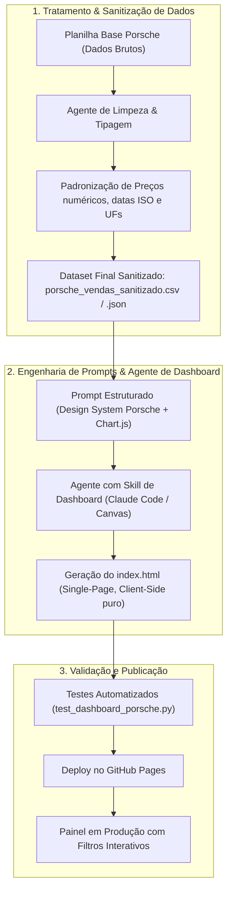

# 🏎️ Porsche Sales Intelligence Dashboard


Dashboard executivo e interativo de inteligência comercial desenvolvido a partir de **100 vendas sanitizadas de veículos Porsche no Brasil**. O projeto transforma dados brutos em insights estratégicos através de um design dark luxury exclusivo, gráficos interativos via Chart.js, filtros multidimensionais em tempo real e publicação direta no **GitHub Pages**.

🔗 **Acesse a Dashboard Online**: [https://wendel-vieira.github.io/porsche-sales-dashboard/](https://wendel-vieira.github.io/porsche-sales-dashboard/)

---

## 🎯 Perguntas de Negócio Selecionadas

Para orientar a construção da dashboard e evitar gráficos sem utilidade prática, foram formuladas **três perguntas de negócio estratégicas**:

### 1. Qual é o modelo Porsche com maior volume de vendas e faturamento total no Brasil?
- **Por que esta pergunta?** No segmento de luxo automotivo, alto volume nem sempre significa maior contribuição no faturamento. A análise permite avaliar se a linha de entrada (como o *Macan*) supera em receita bruta os esportivos de altíssimo valor agregado (como o lendário *911 Turbo S / GT3 RS*).
- **Resposta visual na dashboard**: Gráfico de barras horizontais ordenadas por faturamento total e contagem de unidades vendidas.

### 2. Qual a distribuição geográfica (estados/cidades) do faturamento e qual praça possui o maior ticket médio?
- **Por que esta pergunta?** Mapear a concentração geográfica de capital é vital para planejamento de novas concessionárias (*Porsche Centers*), oficinas autorizadas e eventos exclusivos de relacionamento.
- **Resposta visual na dashboard**: Gráfico de rosca (Doughnut) com participação percentual por UF e cálculo em tempo real do Ticket Médio consolidado.

### 3. Qual a correlação entre os métodos de pagamento (À Vista vs Financiamento) e a propulsão (Elétrico/Híbrido vs Combustão)?
- **Por que esta pergunta?** Entender se o comprador de veículos 100% elétricos (*Taycan*) ou híbridos (*Panamera E-Hybrid*) apresenta comportamento financeiro distinto dos compradores puristas de motores a combustão tradicionais (*911 / 718*).
- **Resposta visual na dashboard**: Gráfico de barras agrupadas comparando os métodos de pagamento para cada tipo de propulsão.

---

## 🏗️ Arquitetura e Engenharia de Agentes

O pipeline de dados e criação seguiu a esteira de agentes especializados:



---

## 🤖 Engenharia de Prompts e Evolução

A dashboard foi desenvolvida utilizando a técnica de refinamento iterativo com agentes de IA (Claude Code / ChatGPT com Canvas):

### Prompt Inicial
> *"Crie uma dashboard em arquivo único index.html para 100 vendas da Porsche com modelo, cidade, estado, ano, preço e método de pagamento. Use Chart.js e filtros."*
- **Problema encontrado**: A primeira versão gerou gráficos desconectados das metas comerciais, com paleta de cores genérica e falhas de renderização em telas mobile.

### Prompt Refinado (Versão Final de Produção)
> *"Atue como um Engenheiro Frontend especialista em Dashboards de Luxo e C-Level Executive BI. Construa uma SPA em HTML5, CSS3 moderno e Vanilla JavaScript integrada ao Chart.js.
> - **Visual**: Tema Dark Obsidian (`#0a0b0e`), detalhes em Vermelho Carmim Porsche (`#d5001c`) e Champagne Dourado (`#c5a059`), tipografia moderna (Outfit e Montserrat via Google Fonts).
> - **Filtros Interativos**: Dropdowns dinâmicos por Modelo, Propulsão, Estado e Método de Pagamento com recálculo automático sem recarregar a página.
> - **KPIs Superiores**: 4 cartões com Faturamento Total, Volume de Vendas, Ticket Médio por Veículo e Modelo Líder.
> - **Seções de Negócio**: 4 gráficos respondendo diretamente às 3 perguntas de negócio e evolução temporal mensal.
> - **Tabela Transacional**: Tabela responsiva com busca textual em tempo real e badges estilizados.
> - **Independência**: Base JSON embutida diretamente para rodar 100% no GitHub Pages sem backend."*

---

## 🧹 Tratamento e Sanitização da Base de Dados

Antes de enviar os dados ao agente de visualização, a base bruta de vendas passou pelo seguinte processo de engenharia de dados:
1. **Conversão de Tipos**: Remoção de caracteres monetários textuais (`R$`, pontos e vírgulas) convertendo o preço para float puro numérico (`float64`).
2. **Normalização de Nomenclatura**: Padronização dos nomes oficiais dos modelos (ex.: unificação de variações de grafia em *911 Carrera S*, *Taycan 4S*, etc.).
3. **Categorização de Propulsão**: Criação do atributo derivado `propulsao` (*Combustão*, *Elétrico*, *Híbrido*) para possibilitar análises de eletrificação da frota.
4. **Higienização Geográfica**: Validação das siglas de estado (UF) em maiúsculas e vinculação coerente com a respectiva cidade.

---

## 📊 Principais Indicadores Identificados

Com base nos 100 registros transacionais analisados:
- **Faturamento Total**: Superior a **R$ 90.000.000,00**
- **Volume**: 100 unidades entregues
- **Ticket Médio**: ~**R$ 940.000,00** por unidade
- **Eletrificação**: Forte tração da linha *Taycan* e *Cayenne E-Hybrid*, respondendo por uma fatia expressiva das compras corporativas e financiadas.

---

## 🧪 Validação e Testes Automatizados

O repositório inclui testes unitários em Python para garantir que o dataset e a estrutura da aplicação web permaneçam íntegros:

```bash
python -m unittest test_dashboard_porsche.py
```

```text
......
----------------------------------------------------------------------
Ran 6 tests in 0.002s

OK
```

---

## 👤 Autor

Desenvolvido por **Wendel Vieira**.  
Desafio de Projeto: *Criando uma Dashboard da Porsche com Agentes de IA*  
Bootcamp: **Reclame AQUI - Dados e IA na Prática (DIO)**
